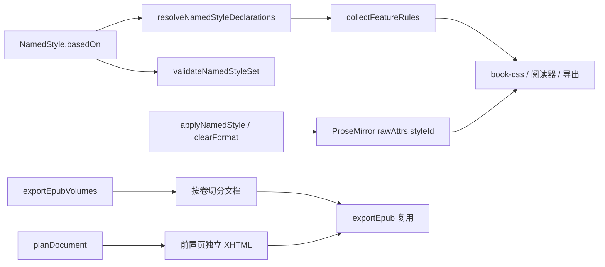

## 产品概述

P1-B 第一批（P1-B1）聚焦「样式体系」与「EPUB 导出结构」三件事：让命名样式支持 Word 式「依据」继承并可批量套用 / 清除格式；支持按卷导出多个 EPUB；让封面、书名页、版权页等前置页各自成为独立 XHTML 文件。

## 核心功能

- **命名样式继承**：命名样式可指定「依据」另一命名样式，声明按链式合并；检测缺失依据、循环引用、重复 id；阅读与导出侧样式表按合并结果扁平输出。
- **批量样式操作**：工具栏可对当前选区批量套用指定命名样式、一键清除格式（标记与命名样式），操作可撤销。
- **样式管理界面**：样式面板为每个命名样式提供「依据」下拉，并展示继承来源；保留改名、改声明、删除能力。
- **分卷 EPUB 导出**：含多个「卷」的文档可一次导出多个 EPUB，每卷目录仅含本卷章节；无卷文档行为与现有单本导出一致。
- **前置页独立成章**：封面、书名页、版权页、封底各自输出独立 XHTML，spine 顺序与原文档一致，且不进入目录；输出对应 EPUB 语义类型。

## 范围边界

- 本批只做 C10、E2、E4；F5 / F6 / K2 / K4 / K5 留待 P1-B2。
- 仓库无 `exporter-docx` 包，C10 不做 Word `styles.xml` 映射。
- 不改动 P1-A 已交付的分栏 / 对页 / 分栏符行为。

## 技术栈

- 语言与工程：TypeScript monorepo（pnpm workspaces），ESM，Vitest。
- 涉及包：`@bibliotype/core`（样式契约）、`@bibliotype/layout`（CSS 生成）、`@bibliotype/editor`（命令）、`@bibliotype/exporter-epub`（打包）、`apps/demo`（样式面板与工具条）。
- 零新增依赖；沿用现有 `scoped()`、具名导出、纯函数与确定性导出约定。

## 实现方案

### 总体策略

采用「契约先行、渲染扁平、命令原子、导出复用」四条主线：

1. **契约先行（C10）**：`NamedStyle` 增可选 `basedOn`，新增纯函数解析继承链与结构校验；`styleId` 仍走 `rawAttrs`，不写入正式 IR 属性，保持导入器「不认识即丢弃」的无损约定。
2. **渲染扁平**：CSS 无法跨规则继承，故在 `collectFeatureRules` 生成 `[data-style-id]` 规则时改用解析后的合并声明，保证阅读器、分页画布、EPUB / PDF 导出共用同一结果。
3. **命令原子**：`applyNamedStyle` 与 `clearFormat` 各自单事务、可撤销；无选区或不适用时返回 false，不产生空事务。
4. **导出复用**：`exportEpubVolumes` 只做「按卷切分文档 + 复用 `exportEpub`」，不复制 OPF / NAV / NCX 打包逻辑；前置页只调整 `planDocument` 的文件切分与 `epub:type`，不改正文序列化。

### 关键决策与权衡

- **`basedOn` 放主题层而非 IR**：样式是书籍级资产；写入节点会污染 IR 并破坏导入往返。代价是导出到第三方格式时需自行扁平化（本批已做）。
- **环引用不抛异常**：返回空声明并产出结构化 issue，避免损坏的样式设置让整本书无法渲染。
- **分卷标识符确定性派生**：以基础 identifier + 卷序号生成，禁止时间戳 / 随机数，满足既有导出确定性红线。
- **前置页不进目录**：目录仍只认结构节点与顶层标题，避免封面 / 版权页污染导航；spine 顺序由原文档顺序决定。

### 性能与可靠性

- 继承链解析为 O(链长)，结果可按 `NamedStyleSet` 引用缓存；样式数量为个位数到数十，构建样式表不构成瓶颈。
- 分卷导出按卷复用同一文档切片，内存峰值与单卷大小成正比；不重复解析整书。
- 前置页切分只增加常量级文件数，不改变 `splitSections` 的体积兜底逻辑。
- 所有新函数保持纯函数与确定性输出，便于快照测试。

## 架构设计



## 目录结构与改动文件

```
note_npm/
├── packages/core/src/
│   ├── theme/
│   │   ├── feature-style.ts            # [MODIFY] NamedStyle 增 basedOn；具名导出新解析/校验函数
│   │   └── named-style-resolve.ts      # [NEW] 继承链合并、环检测、样式集合校验（纯函数）
│   ├── settings/style-settings.ts      # [MODIFY] 快照归一化保留 basedOn，兼容旧数据
│   ├── index.ts                        # [MODIFY] 导出解析与校验 API 及其类型
│   └── __tests__/named-style-resolve.test.ts  # [NEW] 合并顺序、环、缺失依据、旧数据兼容
├── packages/layout/src/html/
│   ├── feature-selectors.ts            # [MODIFY] collectFeatureRules 使用解析结果扁平输出
│   └── __tests__/feature-selectors.test.ts    # [MODIFY] 增依据链扁平化断言
├── packages/editor/src/
│   ├── commands.ts                     # [MODIFY] applyNamedStyle / clearFormat（单事务、可撤销）
│   ├── index.ts                        # [MODIFY] 具名导出新命令
│   └── __tests__/named-style-commands.test.ts # [NEW] 批量套用、清除标记、空选区返回 false
├── apps/demo/src/
│   ├── composables/use-style-settings.ts      # [MODIFY] setNamedStyleBasedOn、创建时支持 basedOn
│   ├── components/SettingsPanel.vue           # [MODIFY] 命名样式行增加「依据」下拉与来源提示
│   └── components/EditorToolbar.vue           # [MODIFY] 样式下拉批量应用、清除格式按钮与禁用态
├── packages/exporter-epub/src/
│   ├── volumes.ts                      # [NEW] exportEpubVolumes：按卷切分、确定性标识、复用 exportEpub
│   ├── sections.ts                     # [MODIFY] 新增前置页类型集合，前置页各成独立文件且不入目录
│   ├── xhtml.ts                        # [MODIFY] 按节点类型输出 epub:type 映射
│   ├── index.ts                        # [MODIFY] 导出分卷 API 与类型
│   ├── cli.ts                          # [MODIFY] 可选 --volumes 输出目录（解析复杂则本批只交付 API）
│   └── __tests__/
│       ├── volumes.test.ts             # [NEW] 两卷产物、目录隔离、无卷等价单本
│       └── front-matter.test.ts        # [NEW] 前置页文件数、spine 顺序、目录不含前置页
├── docs/
│   ├── 11-theme-tokens.md              # [MODIFY] 命名样式依据与扁平化规则
│   ├── 07-export-epub.md               # [MODIFY] 分卷导出与前置页 XHTML
│   └── 19-editor-toolbar-usage.md      # [MODIFY] 批量应用样式 / 清除格式用法
└── .changeset/p1b1-named-style-export.md # [NEW] 覆盖 core/layout/editor/exporter-epub 的 minor
```

## 关键接口

```ts
/** 命名样式：basedOn 指向另一命名样式，声明按链合并 */
export interface NamedStyle {
  id: string;
  name: string;
  featureId: FeatureStyleId;
  basedOn?: string;
  declarations: FeatureDeclarations;
}

/** 解析继承链后的扁平声明；缺失依据或成环时返回已收集部分（不抛异常） */
export function resolveNamedStyleDeclarations(
  set: NamedStyleSet,
  id: string,
): FeatureDeclarations;

/** 样式集合结构问题（缺失依据 / 环 / 重复 id） */
export function validateNamedStyleSet(set: NamedStyleSet): NamedStyleIssue[];
```

```ts
/** 分卷导出产物（name 供文件名，index 自 0 起） */
export interface EpubVolumeOutput {
  name: string;
  index: number;
  bytes: Uint8Array;
}

/** 按卷导出；无卷文档返回单卷，等价 exportEpub */
export function exportEpubVolumes(
  document: BookDocument,
  options?: EpubExportOptions,
): EpubVolumeOutput[];
```

## 实施要点

- 继承合并顺序为「祖先在前、后代覆盖」，同一属性后者胜出；空声明视为不覆盖。
- `clearFormat` 需同时清除 `marks` 与 `rawAttrs.styleId`，保留块结构与节点 id。
- 分卷时封面 / 前置页只随首卷导出，避免多卷重复；卷名缺省用「卷 N」。
- 前置页 `epub:type` 映射：封面 `cover`、书名页 `titlepage`、版权页 `copyrightpage`、封底不输出类型。
- 既有 EPUB 测试若断言文件数，按新语义更新并在交付报告中单列说明。

## Agent Extensions

### SubAgent

- **code-explorer**
- 用途：在改动 `NamedStyle` / `styleId` 前，以 medium 深度梳理 core、layout、editor、vue、demo 与导出器的全部消费点，确认新增可选字段不会破坏既有调用。
- 预期结果：输出「文件 + 符号 + 调用关系」清单，作为 C10 契约与命令实现的改动边界依据。