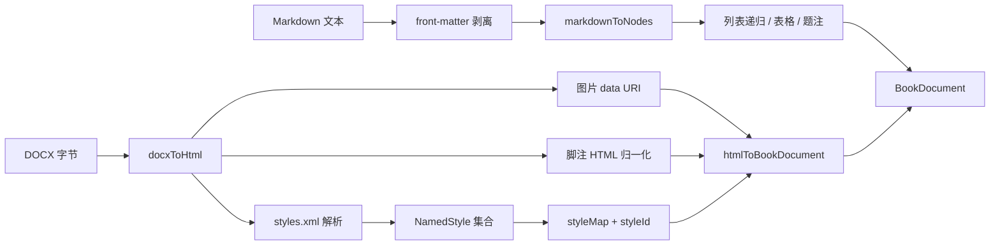

## Product Overview

P1-B2a 聚焦导入链路：让 DOCX 导入保留图片、命名样式与脚注，让 Markdown 导入支持嵌套/松散列表、GFM 表格、图片题注与 front-matter。P1-B2 的 K2（校勘对照）、K4（索引生成）、K5（印章/版心）归入 P1-B2b，另行确认。

## Core Features

- **DOCX 图片默认内联**：不再留下空 `src` 占位，图片以 data URI 进入文档；仍允许调用方注入自定义资源转换器覆盖默认行为。
- **DOCX 命名样式映射**：解析 `word/styles.xml`，把中文样式名、基于关系与常用段落/文字格式映射为命名样式；正文中引用该样式的段落带上可渲染的样式标识。
- **DOCX 脚注映射**：把 Word 脚注转换为正文上标注码与书末注文节点，编号连续、可回跳。
- **Markdown 嵌套与松散列表**：支持 3 层及以上缩进、列表项内多段落，层级往返不丢失。
- **Markdown GFM 表格**：管道表格转为文档表格，表头行与左/中/右对齐正确映射，支持转义竖线。
- **Markdown 图片题注**：独占一行图片后的斜体行或图片 title 转为图注，与图片成对输出。
- **Markdown front-matter**：开头 YAML 子集解析为书目元数据（书名/作者/语言/日期/简介），正文不残留分隔头；调用方显式传入的元数据优先。

## Scope Boundaries

- 只做 F5、F6；K2/K4/K5 不在本批。
- 不新增生态依赖，仅复用工作区已有的解包与 XML 解析库。
- DOCX 样式只映射常用子集（加粗、斜体、下划线、字号、颜色、首行缩进、行距、段前段后），制表位、边框、主题字体等不映射。
- Markdown 只补清单列出的四类语法；HTML 块、引用嵌套、数学公式不在本批。
- front-matter 仅在导入层生效，编辑器粘贴 Markdown 不解析。

## Tech Stack

- TypeScript monorepo（pnpm workspaces）、ESM、Vitest；零新增生态依赖。
- 涉及包：`@bibliotype/editor`（Markdown 解析）、`@bibliotype/import`（HTML/文档组装）、`@bibliotype/import-docx`（DOCX 归一化）。
- 复用工作区既有库：`fflate`（解包）、`@xmldom/xmldom`（XML 解析），与 `import-epub` 同源。

## Implementation Approach

分两条互不依赖的链路推进，最后统一收口：

1. **F6 先行**：`packages/editor/src/markdown.ts` 是手写行级解析器，先把它从「逐行列表」升级为「缩进栈 + 递归块解析」，再补 GFM 表格与图片题注；front-matter 放在 `packages/import`（metadata 属文档级，不应进编辑器解析器）。
2. **F5 随后**：`docxToHtml` 先把图片默认策略切到 data URI；再在 HTML 产出后做脚注归一化（不依赖 mammoth 内部结构）；最后解析 `word/styles.xml` 生成命名样式，并通过动态 `styleMap` 让段落带上样式标识。
3. **兼容优先**：`docxToBookDocument` 与 `markdownToNodes` 的既有签名不变；新增能力通过新增函数或可选选项暴露。

关键决策：

- **脚注走 HTML 后处理**：mammoth 已把脚注输出为「上标链接 + 文末列表」，在 `docx-html` 层归一为带 `data-*` 的稳定结构，再由 `import` 的 HTML 规则转 IR，避免与 mammoth 内部 AST 耦合。
- **样式标识走 `styleId`**：DOCX 样式名映射为 `ns-docx-*`，段落通过 `styleId` 挂载，沿用既有命名样式 CSS 链路，不新增节点类型。
- **front-matter 不污染正文**：解析后从 Markdown 文本中剥离，再交给 `markdownToNodes`；调用方显式 metadata 优先，避免导入覆盖用户输入。

性能与可靠性：

- 解析均为线性扫描；列表递归深度受缩进层级约束，表格按行解析，复杂度 O(行数 × 列数)。
- 样式表解析只做一次解包与一次 XML 遍历，样式数量为个位到数十，不构成瓶颈。
- 所有新函数保持确定性：不读当前时间、不生成随机 id；脚注编号按出现顺序递增。

## Architecture Design



## Directory Structure

```
note_npm/
├── packages/editor/src/
│   ├── markdown.ts                         # [MODIFY] 列表缩进栈、GFM 表格、图片题注；保持 markdownToNodes 签名
│   ├── markdown-blocks.ts                  # [NEW] 列表/表格/题注的块级解析纯函数，避免 markdown.ts 继续膨胀
│   └── __tests__/markdown-full.test.ts     # [NEW] 3 层嵌套、松散列表、表格对齐、两种题注、脚注回归
├── packages/import/src/
│   ├── front-matter.ts                     # [NEW] YAML 子集解析与剥离，返回 { metadata, body }
│   ├── from-markdown.ts                    # [MODIFY] 先剥离 front-matter，再合并 metadata（调用方优先）
│   ├── from-html.ts                        # [MODIFY] 识别 sup[data-note-ref] 与 aside[data-footnote-id]
│   └── __tests__/front-matter.test.ts      # [NEW] title/author/language/date 解析、正文无残留、显式值优先
├── packages/import-docx/src/
│   ├── docx-html.ts                        # [MODIFY] 图片默认 data URI；脚注 HTML 归一化；动态 styleMap 入口
│   ├── docx-styles.ts                      # [NEW] styles.xml 解包解析 → NamedStyle[] 与 styleId 映射
│   ├── from-docx.ts                        # [MODIFY] 新增 docxToBookDocumentWithStyles；原函数保持签名
│   ├── index.ts                            # [MODIFY] 导出新 API 与类型
│   └── __tests__/docx-full.test.ts         # [NEW] 内联图片、中文样式 + basedOn、脚注往返
├── docs/17-document-import.md              # [MODIFY] DOCX 样式/脚注/图片策略与 Markdown 语法表
└── .changeset/p1b2a-import-full.md         # [NEW] editor / import / import-docx 的 minor
```

## Key Code Structures

```ts
/** DOCX 导入结果（带命名样式，供宿主挂到样式表） */
export interface DocxImportResult {
  document: BookDocument;
  namedStyles: NamedStyleSet;
}

export function docxToBookDocumentWithStyles(
  input: DocxInput,
  schema: Schema,
  metadata: BookMetadata,
  options?: DocxToHtmlOptions,
): Promise<DocxImportResult>;
```

```ts
/** front-matter 解析结果：metadata 为标量字段，body 为剥离后的正文 */
export interface FrontMatterParseResult {
  metadata: Partial<BookMetadata>;
  body: string;
}

export function parseFrontMatter(markdown: string): FrontMatterParseResult;
```

## Implementation Notes

- `markdownToNodes` 保持 `(text, schema) => PmNode[]` 不变；新增块解析函数为纯函数，便于单测。
- 列表递归需限制最大深度（例如 8 层）并在超限时降级为同级段落，避免恶意缩进导致栈溢出。
- 表格列数取表头列数；数据行缺列补空单元格、多列截断，保证 PM 严格树可创建。
- 脚注 id 形如 `fn-docx-1`，与编辑器既有 `note-footnote-*` 命名区分；导入后由 `nextNoteIndex` 继续编号。
- 样式 id 统一 `ns-docx-` 前缀并做字符白名单清洗（`[A-Za-z0-9_-]`），避免 CSS 选择器注入。
- `styles.xml` 缺失时不报错，返回空样式集合；单个样式解析失败跳过该样式并继续。
- 图片 data URI 可能很大，保持 mammoth 默认行为即可，不在导入层做压缩；文档体积提醒由调用方处理。
- 既有测试若断言「列表项单段落」，按新语义更新，并在交付报告中单列。

## Agent Extensions

### SubAgent

- **code-explorer**
- 用途：在改动 `editor/src/markdown.ts` 与 `import-docx` 前，以 medium 深度确认列表/脚注解析的现有分支、`htmlToBookDocument` 的 DOM 规则与 docx fixture 构造方式，避免遗漏调用点。
- 预期结果：输出「文件 + 符号 + 行号 + 调用关系」清单，明确 `markdownToNodes` 的列表分支、`from-html` 的节点识别入口、`docx.test.ts` 的 fixture 生成方式。