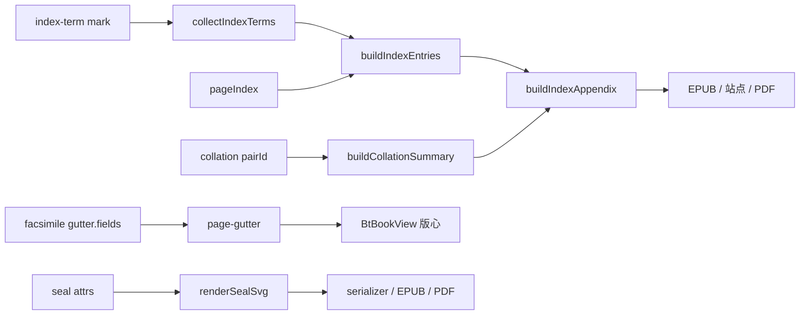

## 产品概述

P1 收尾批次（P1-B2b）补齐三项古籍与学术能力：K4 索引条目与书末索引附录、K5 印章 SVG 与版心文字自动化、K2 校勘配对与并排对照。三项完成后 P1 全部收口。

## 核心功能

- **索引条目**：可对选中文字标记为索引词（term，可另给排序键），标记可跨块、可复制；书末自动生成「索引」附录，按词条分组输出合并页码与回跳链接。
- **索引采集与排序**：同一词条多处命中时页码去重、连续页合并为区间；按拼音（或显式排序键）排序；分页重排后重新采集即更新。
- **三端复用**：索引附录是普通 IR 章节，EPUB、站点、PDF 共用同一份，不各写一套生成逻辑。
- **印章印谱**：印章由确定性 SVG 绘制，支持朱文 / 白文、方印回文与竖排两列、边框粗细；阅读、EPUB、PDF 均可见。
- **版心自动化**：6 套仿真模板各自声明版心字段序列（书名 / 卷次 / 篇卷 / 叶次），版心文字按模板自动推导，鱼尾按字段分段定位。
- **校勘配对**：底本 / 校本段落可成对绑定（同一配对 id、不同角色），校勘记拥有独立连续编号，支持一键重排。
- **校勘对照视图**：同一配对的底本 / 校本段落左右并排（复用分栏或对页容器）；悬浮 / 选中一侧时另一侧同步高亮。
- **校勘汇总表**：书末输出校勘记汇总，每条含编号、配对、异文摘要与回跳链接。

## 范围边界

- 只做 K2、K4、K5；不改动 P0 / P1-A / P1-B1 / P1-B2a 已交付行为。
- 索引条目是行内标记，不新增独立节点；不内置拼音库与笔画库。
- EPUB 无固定页码：索引条目在 EPUB 中回跳正文锚点，页码仅在 PDF / 站点输出。
- 印章以内联 SVG 输出，不打包位图、不新增外部图片资源。
- 对照视图只做阅读层，不做编辑器内并排编辑。
- 不新增第三方依赖。

## 技术栈选择

- TypeScript monorepo（pnpm workspaces）、ESM、Vitest；沿用现有包：`@bibliotype/core`、`editor`、`layout`、`reader`、`vue`、`classical`、`xref`、`exporter-epub`、`exporter-pdf`、`exporter-site`。
- 零新增依赖：排序用 `Intl.Collator` / `localeCompare`，SVG 用字符串模板，页码采集复用 `xref` 既有两遍索引。

## 实施方案

按「K4 契约与附录基建 → K5 印章与版心 → K2 配对与对照」推进，K2 的汇总表复用 K4 的附录构造，避免两套章节生成逻辑。

### K4：索引标记与附录

1. **契约**（core）：新增 `MARK_TYPES.INDEX_TERM = 'index-term'` 行内标记，attrs `{ term, sortKey }`。选 mark 而非 inline node：索引是对既有文字的语义覆盖，加节点会破坏选区、命令与无损往返。
2. **版本**：`IR_SCHEMA_VERSION` 升至 `0.3.0`，新增 `0.2.0 → 0.3.0` 空迁移；`validateDocument` 校验 `term` 非空、`sortKey` 为字符串。
3. **编辑器**：`core-mark-specs.ts` 注册 `span.bt-index-term`；新增 `toggleIndexTerm(term?)`（选中文字时以选中文本为默认 term，无选区返回 false）；`setIndexTermAttrs` 走既有 `setMarkAttrs`。
4. **采集**（xref 新模块）：`collectIndexTerms(document)` 遍历文档收集 `term / sortKey / blockId`；`buildIndexEntries(document, pageIndex, options)` 按词条分组、页码去重排序、连续页合并为区间、记录首个 blockId 供回跳。复杂度 O(节点数 + 词条数 log 词条数)。
5. **附录 IR**：`buildIndexAppendix(entries, options)` 返回 `appendix` 节点（标题「索引」+ 条目段落 + 回跳 link 标记）。EPUB 在 `exportEpub` 追加该节点，站点 / PDF 走既有 IR 链路，三端零分叉。
6. **排序**：缺省 `localeCompare('zh-Hans-CN-u-co-pinyin')`；无 ICU 时退化为码位排序（确定性），`sortKey` 为显式兜底，不引入拼音库。

### K5：印章 SVG 与版心

1. **SVG 纯函数**：`layout/src/svg/seal.ts` 的 `renderSealSvg(options)`，入参 `{ text, style, layout, border, size }`，输出带 `viewBox / role / aria-label` 的确定字符串；方印按右上→右下→左上→左下传统读序排字，白文为朱底留白。
2. **节点接入**：`seal` 增可选 attrs `style / layout / border`；序列化对 `seal` 输出内联 SVG（保留 `data-text` 兼容），EPUB2 退化为文字印章，避免 manifest 与 base64 膨胀。
3. **版心字段**：`FacsimileOptions.gutter` 增可选 `fields`；`PageGutterTexts` 增可选 `volumeTitle`（向后兼容）；6 套模板在 `facsimile-presets.ts` 显式声明字段序列。
4. **推导与鱼尾**：`reader/page-gutter.ts` 从叶块祖先 `volume` 取卷次，按模板字段序列输出文本；`serializePageGutter` 依据字段分段放置鱼尾锚点，不再固定单点。

### K2：校勘配对与对照

1. **契约**（classical）：`collation-mark` 增 `pairId` 与 `role`（base / variant）；`collation-note` 增 `pairId` 与 `marker`；`editor-specs` 与 `note-definitions` 同步。
2. **编号**：`insertCollationNote` 插入时扫描现有 `marker` 取最大值 + 1；新增 `renumberCollationNotes()` 按文档顺序重排，单事务可撤销。
3. **配对命令**：`pairCollation(baseBlockId, variantBlockId)` 写入同一 `pairId` 与不同 `role`，重复配对先解绑；`unpairCollation(pairId)` 清除。均单事务、可撤销。
4. **对照组件**：`vue/src/components/BtCollationCompare.vue` props `{ reader, pairId?, mode }`；按 `pairId` 从 IR 筛出两侧段落，复用 `columns` / facing 布局；hover / 选中一侧时另一侧加 `is-linked` 类。不新建分页内核。
5. **汇总表**：`buildCollationSummary(document)` 复用 K4 的附录构造，条目含编号、配对、异文摘要、回跳 blockId；EPUB 复用 `groupEndnotes` 的章节生成路径。

## 架构设计



## 目录结构

```
packages/core/src/
  ir/mark-types.ts                    # [MODIFY] 新增 INDEX_TERM
  ir/document.ts                      # [MODIFY] IR_SCHEMA_VERSION → 0.3.0
  ir/migrate.ts                       # [MODIFY] 0.2.0 → 0.3.0 空迁移
  ir/validate.ts                      # [MODIFY] index-term 校验
  __tests__/index-term.test.ts        # [NEW] 标记契约、迁移、校验

packages/editor/src/
  core-mark-specs.ts                  # [MODIFY] 注册 index-term parseDOM / toDOM
  commands.ts                         # [MODIFY] toggleIndexTerm / setIndexTermAttrs
  __tests__/index-term-command.test.ts # [NEW] 选区套用、空选区、撤销

packages/xref/src/
  index-terms.ts                      # [NEW] 采集、分组、页码合并、排序
  index-appendix.ts                   # [NEW] buildIndexAppendix / buildCollationSummary
  __tests__/index-terms.test.ts       # [NEW] 同词多页、连续页合并、重排更新
  index.ts                            # [MODIFY] 具名导出

packages/layout/src/
  svg/seal.ts                         # [NEW] renderSealSvg 纯函数
  facsimile.ts                        # [MODIFY] gutter.fields、PageGutterTexts.volumeTitle
  facsimile-presets.ts                # [MODIFY] 6 套模板字段序列
  html/html-serializer.ts             # [MODIFY] seal 输出内联 SVG
  html/book-css.ts                    # [MODIFY] .bt-index-term / seal 兜底样式
  __tests__/seal-svg.test.ts          # [NEW] 确定性与样式分支
  __tests__/page-gutter.test.ts       # [MODIFY] 模板字段映射

packages/reader/src/
  page-gutter.ts                      # [MODIFY] 关键字段序列与卷次推导
  __tests__/page-gutter.test.ts       # [MODIFY] 卷次与字段顺序

packages/classical/src/
  editor-specs.ts                     # [MODIFY] collation attrs（pairId / role / marker）
  editor-commands.ts                  # [MODIFY] 自动编号、配对、解绑、重排
  __tests__/collation-pairing.test.ts # [NEW] 编号连续、配对写入与解绑

packages/vue/src/
  components/BtCollationCompare.vue   # [NEW] 两侧对照与联动高亮
  __tests__/collation-compare.test.ts # [NEW] 段落数量、is-linked 切换
  index.ts                            # [MODIFY] 导出组件

packages/exporter-epub/src/
  epub.ts                             # [MODIFY] 追加索引 / 校勘汇总章节
  __tests__/index-appendix.test.ts    # [NEW] 附录文件与回跳
```

## 关键接口

```ts
/** 索引条目（按词条聚合后） */
export interface IndexEntry {
  term: string;
  sortKey: string;
  /** 合并后的页码区间，如 [3, 5] 表示 3–5 */
  ranges: ReadonlyArray<readonly [number, number]>;
  /** 首个命中块 id（回跳锚点） */
  anchorId: string;
}

/** 印章 SVG 选项 */
export interface SealSvgOptions {
  text: string;
  style?: 'zhu' | 'bai';
  layout?: 'square' | 'column';
  border?: 'none' | 'thin' | 'thick';
  size?: number;
}
```

## 实施要点

- `index-term` 只做标记：复制粘贴、跨块选区、撤销全部走现有 mark 机制，不新增节点注册。
- 页码区间合并只处理升序去重后的页码；单页输出 `3`，连续两页以上输出 `3–5`。
- EPUB 追加章节发生在导出期，不改原文档；与 `groupEndnotes` 的追加方式保持一致。
- SVG 输出禁止时间戳、随机 id 与浮点抖动；同输入必须字节一致。
- 模板字段缺省时回退 `DEFAULT_GUTTER_FIELDS`，非仿真路径零变化。
- 校勘编号只认 `marker` 数字，忽略非数字；配对 id 用确定性前缀（`pair-` + 序号），不读时间。
- 既有古典 CSS 基线可能因 `.bt-index-term` / seal 兜底样式变化，需重锁并在报告中单列。

### SubAgent

- **code-explorer**
- 用途：在改 `MARK_TYPES`、`validateDocument`、序列化分支与 classical 规格前，以 medium 深度确认标记注册、IR 校验、collation 规格与 reader 版心字段的全部消费点。
- 预期结果：输出「文件 + 符号 + 行号 + 调用关系」清单，明确新增标记与 attrs 的改动边界，避免遗漏两层注册同步。