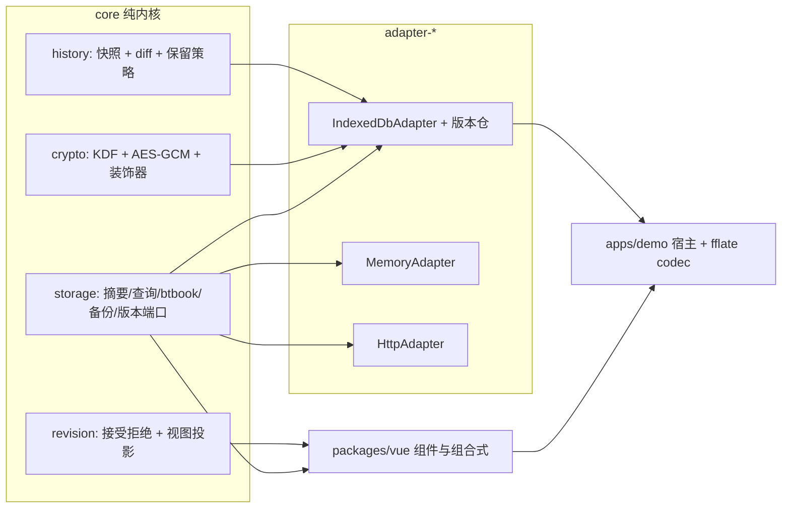

## 产品概述

在现有排版、编辑、阅读内核之上，补齐两块产品能力：把「只能列出书」升级为「能管理书」的本地书库（书架、备份迁移、加密隐私），并为编辑器补上「修订留痕」与「版本历史」，让改稿过程可追溯、可回退。

## 核心功能

### 一、书架能力（H3）

- 书目摘要从「标题 + 更新时间」扩展为含封面缩略图、字数、阅读进度、标签、最近阅读时间、作者的完整书架条目；旧数据缺字段自动回退，不报错。
- 支持按标题 / 作者 / ISBN / 标签检索，支持按最近阅读、更新时间、标题、字数排序与按标签分组。
- 提供单书 `.btbook` 单文件包：一本书的元数据、正文、资产、注记可整体导出并在另一实例导入，封面与阅读进度一并还原。
- 书架界面提供网格/列表两种视图、封面占位、进度条、标签筛选与检索框，空库有引导占位。

### 二、备份与迁移（H4）

- 整库备份：一次导出包含书目清单、每本书包、样式与设置的压缩包；导入时逐书校验，坏包跳过并在失败清单中列出原因，不中断整批。
- 同 id 冲突提供三种策略：合并（保留较新）、覆盖、保留双份（生成「副本」而非覆盖）。
- 备份/恢复过程显示进度与当前书名，结束后给出「成功 / 跳过 / 失败」汇总。

### 三、加密与隐私（H5）

- 可对书库正文与资产开启加密，开启后底层存储内容不可读；口令错误时给出明确提示且不损坏数据。
- 注记可独立加密：只锁笔记与批注，不影响正文阅读。
- 导出支持脱敏：可隐藏批注、作者信息与阅读进度。
- 提供解锁、设置、关闭加密的界面，并在会话内记忆解锁状态。

### 四、修订模式（C5）

- 开启修订后，插入、删除、格式变更三类改动自动留痕，记录作者与时间。
- 修订视图可切换「显示标记 / 呈现终稿 / 显示原稿」；删除内容在标记视图保留并加删除线，终稿视图隐去。
- 支持单条与全部接受/拒绝；格式变更被拒绝时恢复原有样式。
- 修订侧栏按条目列出改动，点击可定位到正文对应位置。
- 导出默认输出终稿，可选择导出带修订标记版本。

### 五、版本历史（C7）

- 支持手动打点与自动快照（带标签），快照持久化后可跨会话查看。
- 版本对比展示节点级新增、删除、修改与文本内联差异，支持左右分栏与行内两种视图。
- 一键回滚到任一版本，回滚前校验文档合法性，不合法则拒绝并说明原因。
- 支持保留策略（最多 N 份 / 按天保留），可清理旧快照。

### 交付口径

五项均需「导出符号 + 测试（含负例）+ 文档回写 + changeset」齐备，并配 Vue 组件与 demo 接线，不得只交付内核。

## 技术栈

- 语言/构建：TypeScript（ES2020、`strict`、`verbatimModuleSyntax`）+ pnpm workspace + turbo + tsup；测试 vitest（Node 环境为主，IDB 用 `fake-indexeddb`）。
- 前端：Vue 3 组件 + 组合式函数（`packages/vue`），demo 为 Vite 单页应用。
- 密码学：`globalThis.crypto.subtle`（Node 20 / 浏览器原生），PBKDF2 默认、可插拔 KDF。
- ZIP：**端口注入**，包内不引入压缩库；`apps/demo`（private，不发布）以 devDependency 使用仓库已有的 `fflate` 提供 codec。
- **生产依赖零新增**：仅允许 devDependencies（`fake-indexeddb`、demo 的 `fflate`）；H2/G2 新包不在本轮。

## 实现策略

### 1. 端口扩展一律「可选能力 + 运行期探测」

不修改 `StorageAdapter` 必选方法（保三实现与 demo 自动保存不受影响），新增独立端口并按 `isAssetStore` 范式提供类型守卫：

```ts
// packages/core/src/storage/query.ts
export interface BookLibraryStore {
  readonly name: string;
  query(query: DocumentQuery): Promise<BookQueryResult>;
  updateSummary(id: string, patch: Partial<DocumentSummary>): Promise<void>;
}
export function isBookLibraryStore(value: unknown): value is BookLibraryStore;
```

`DocumentSummary` 仅追加**全部可选**字段（`author? / tags? / coverThumbnail? / wordCount? / progress? / lastOpenedAt?`），旧记录缺字段由纯函数 `mergeDocumentSummary()` 回退，IDB 升级只加索引不重写旧记录。

### 2. 纯函数内核 + 薄适配层

所有可测逻辑放 `core` 纯函数：摘要构建、查询排序分组、`.btbook` 文件规划、备份编排、接受/拒绝修订、快照与 diff、脱敏。适配层只做 IO：IDB 索引取数、版本仓读写、HTTP `list + 纯函数过滤`（服务端无新端点，`docs/29` 注明能力差异）。

### 3. `.btbook` 与整库备份共用一套包格式

core 定义 `BookPackFile[]`（`manifest.json` / `document.json` / `assets/<hash>` / `annotations.json`）与 `BookPackCodec { zip, unzip }` 端口；`packBookArchive` / `unpackBookArchive` 只做文件规划与校验，压缩由宿主注入。整库备份复用同一 codec，避免第二套打包逻辑。

### 4. 修订模式：文档内保留 + 视图投影

- `MARK_TYPES` 增 `insertion / deletion / format-change`，attrs 为 `{ changeId, author, timestamp, previous? }`；`timestamp` 由命令参数注入，保证确定性。
- 记录方式沿用既有 `appendTransaction` 范式（`editor/src/input-rules.ts:263`）：`filterTransaction` 把「删除」改写为「保留原文并加 deletion 标记」，`appendTransaction` 为新增文本加 insertion、为 mark 变更加 format-change。
- 接受/拒绝用 core 纯函数 `acceptRevisions / rejectRevisions / projectDocument(doc, view)` 统一实现，`layout` 序列化新增 `revisionView` 选项（`final` 为导出默认），CSS 走 `scoped()` 前缀。
- 权衡：相比「删除即丢内容 + 旁路记录」，保留内容使拒绝可无损恢复，代价是修订态文档体积增大、终稿需投影，故导出前统一走 `final` 投影。

### 5. 历史版本：节点级结构 diff

`diffDocuments(a, b)` 对子节点按 `id → type+路径` 对齐做 LCS，再对文本节点做字符级内联 diff（复用 `diffTextReplace` 的思路，在 core 重写为纯函数，避免 core 依赖 vue）。复杂度 O(n·m) 仅作用于同父层子序列，1000 块文档为毫秒级；快照按保留策略裁剪，避免存储膨胀。

### 6. 加密：装饰器而非侵入式改造

`createEncryptedStorageAdapter({ inner, keyring })` 与 `createEncryptedAssetStore(...)` 在 `save/load`、`putAsset/getAsset` 边界做 AES-GCM 加解密，IDB 只看到密文分片；注记通过 `annotation` 包的同款装饰器用独立 `notesKey`。密钥只存内存，`CryptoError` 带稳定 code（`WRONG_KEY` / `NOT_UNLOCKED` / `CORRUPT_PAYLOAD`）。权衡：全量加解密有 CPU 成本，故按「文档级 + 资产级」粒度处理，仅解锁时一次性派生密钥并缓存 `CryptoKey`。

### 7. UI：模型函数 + 纯展示组件

沿用 `BtAnnotationSidebar.vue` + `annotation-model.ts` 的范式：新增 `BtBookShelf` / `BtBackupPanel` / `BtEncryptionPanel` / `BtRevisionSidebar` / `BtVersionHistory`，配套 `use-book-library` / `revision-model` / `version-model` 承载状态与派生数据，组件只负责视图与事件。

## 架构



## 性能与可靠性

- 书架查询：摘要常驻 meta 仓，`query()` 只读摘要不解析全文；50 本规模下全量过滤 O(n) 足够，预留 `tags` 索引。
- 字数统计：`save` 时用 `countDocumentStats` 计算一次并落库，书架渲染不再遍历 IR。
- 修订/历史：投影与 diff 均为纯函数，编辑期间不参与渲染热路径；侧栏模型按内容哈希 memo。
- 备份：逐书串行处理 + 进度回调，单本失败进入失败清单继续，内存峰值按单书控制。
- 加密：`CryptoKey` 缓存于内存，避免每次读写重复派生；错误一律结构化，禁止静默降级为明文。

## 目录结构

```text
packages/core/src/
├── storage/
│   ├── types.ts                    # [MODIFY] DocumentSummary 增可选字段（author/tags/coverThumbnail/wordCount/progress/lastOpenedAt），补兼容说明
│   ├── library.ts                  # [NEW] buildDocumentSummary / mergeDocumentSummary / normalizeTags / clampProgress：摘要构建与旧数据回退
│   ├── query.ts                    # [NEW] DocumentQuery / BookQueryResult / BookLibraryStore / isBookLibraryStore / queryDocumentSummaries / sortAndGroup
│   ├── btbook.ts                   # [NEW] BTBOOK_FORMAT_VERSION / BookPackManifest / BookPackFile / buildBookPackFiles / parseBookPackFiles / BookPackCodec / packBookArchive / unpackBookArchive
│   ├── backup.ts                   # [NEW] LIBRARY_BACKUP_VERSION / CONFLICT_STRATEGIES / buildLibraryBackupFiles / restoreLibrary（三策略、逐书校验、进度与失败清单）
│   └── version-store.ts            # [NEW] DocumentSnapshot / DocumentVersionStore / isDocumentVersionStore / SnapshotRetentionPolicy / applyRetentionPolicy
├── crypto/
│   ├── errors.ts                   # [NEW] CRYPTO_ERROR_CODES / CryptoError（中文消息 + 修复指向）
│   ├── kdf.ts                      # [NEW] Kdf 端口 / deriveKeyPbkdf2（salt、iterations 可注入）
│   ├── aes-gcm.ts                  # [NEW] encryptBytes / decryptBytes / EncryptedEnvelope（版本 + iv + cipher，随机源可注入）
│   └── adapters.ts                 # [NEW] createEncryptedStorageAdapter / createEncryptedAssetStore（透明加解密装饰器）
├── revision/
│   ├── revision-marks.ts           # [NEW] REVISION_MARK_TYPES / RevisionAttrs / collectRevisions / buildChangeId
│   └── accept-reject.ts            # [NEW] acceptRevisions / rejectRevisions / projectDocument(view: marked|final|original)
├── history/
│   ├── snapshot.ts                 # [NEW] createDocumentSnapshot / restoreSnapshot（回滚前 validateDocument）
│   └── diff.ts                     # [NEW] diffDocuments / diffNodes / inlineTextDiff
├── privacy/redact.ts               # [NEW] RedactOptions / redactDocument / redactAnnotations（隐藏批注、作者、进度）
└── index.ts                        # [MODIFY] 导出以上全部公开符号与类型

packages/adapter-indexeddb/src/
├── indexeddb-adapter.ts            # [MODIFY] 版本升 3、摘要落库与可选字段、实现 BookLibraryStore
├── library-queries.ts              # [NEW] 复用 core 纯函数的 IDB 摘要查询与 updateSummary
├── memory-adapter.ts               # [MODIFY] 同步可选字段并实现 BookLibraryStore
├── version-store.ts                # [NEW] IndexedDbVersionStore / MemoryVersionStore（快照仓 + 保留策略）
├── index.ts                        # [MODIFY] 导出新适配器与类型
└── __tests__/
    ├── storage-contract.ts         # [NEW] 公共契约测试套件（save/load/list/delete/clear/close + 可选能力探测）
    ├── memory-adapter.test.ts      # [MODIFY] 改用公共 suite
    ├── indexeddb-adapter.test.ts   # [MODIFY] 改用公共 suite
    ├── library.test.ts             # [NEW] 查询/排序/分组/旧数据回退
    └── version-store.test.ts       # [NEW] 快照 CRUD、保留策略、幂等

packages/adapter-http/src/
├── adapter.ts                      # [MODIFY] 摘要可选字段兼容校验、实现 query（list + core 纯函数，服务端零改动）
└── __tests__/adapter-http.test.ts  # [MODIFY] 补可选字段与查询用例

packages/annotation/src/
├── encrypted-storage.ts            # [NEW] createEncryptedAnnotationStorage（独立 notesKey，复用 core 加密装饰器）
└── index.ts                        # [MODIFY] 导出加密注记存储

packages/editor/src/
├── core-mark-specs.ts              # [MODIFY] 增 insertion / deletion / format-change 规格与 parseDOM
├── revision-plugin.ts              # [NEW] createRevisionTrackingPlugin（filterTransaction 改写删除 + appendTransaction 打标）
├── revision-commands.ts            # [NEW] setRevisionMode / setRevisionView / acceptRevision / rejectRevision / acceptAll / rejectAll
├── index.ts                        # [MODIFY] 导出插件与命令
└── __tests__/revision.test.ts      # [NEW] 三类修订接受/拒绝矩阵、往返、原子性

packages/layout/src/
├── html/html-serializer.ts         # [MODIFY] SerializeNodeOptions 增 revisionView，按视图投影输出与包装
├── html/book-css.ts                # [MODIFY] scoped 修订样式（插入下划线/删除线/格式变更标记），无全局选择器
├── index.ts                        # [MODIFY] 导出 revisionView 相关类型
└── __tests__/revision-serialization.test.ts  # [NEW] 三视图输出、直排样式、非法视图回退

packages/vue/src/
├── book-shelf-model.ts             # [NEW] 书架视图模型（分组/排序/标签筛选/进度格式化，纯函数）
├── use-book-library.ts             # [NEW] 书架状态：list/query/updateSummary/导入导出包（codec 由参数注入）
├── components/BtBookShelf.vue      # [NEW] 网格/列表双视图、封面占位、进度条、标签筛选、检索
├── components/BtBackupPanel.vue    # [NEW] 整库导出/导入、策略选择、进度与失败清单
├── components/BtEncryptionPanel.vue# [NEW] 开启/解锁/关闭加密、注记独立密钥、脱敏导出选项
├── revision-model.ts               # [NEW] 修订条目纯函数模型（按作者/类型分组、定位）
├── components/BtRevisionSidebar.vue# [NEW] 修订列表 + 单条/全部接受拒绝 + 视图切换
├── version-model.ts                # [NEW] 版本条目与 diff 渲染模型
├── components/BtVersionHistory.vue # [NEW] 版本列表、左右/行内对比、一键回滚
├── index.ts                        # [MODIFY] 导出 5 个组件、3 个模型与组合式函数
└── __tests__/                          # [NEW/MODIFY] 书架模型、修订模型、版本模型断言

apps/demo/src/
├── zip-codec.ts                    # [NEW] 基于 fflate 的 BookPackCodec 适配（仅 demo 宿主提供）
├── composables/use-demo-library.ts # [NEW] 组合 IDB + 版本仓 + 加密 + codec，供各面板复用
├── components/LibraryDrawer.vue     # [NEW] 书架/备份/加密抽屉容器
└── App.vue                         # [MODIFY] 接入抽屉入口、修订侧栏与版本面板，保持既有布局

docs/
├── 10-storage-adapters.md          # [MODIFY] 摘要字段、BookLibraryStore、.btbook、备份策略、版本仓、加密
├── 02-editor-and-plugins.md        # [MODIFY] 修订 mark、命令、插件与历史版本 API
├── 05-layout-and-html.md           # [MODIFY] revisionView 三态序列化与样式
├── 06-vue-integration.md           # [MODIFY] 新增组件与 props/事件
├── 24-annotation.md                # [MODIFY] 注记独立密钥与脱敏
├── 29-adapter-http.md              # [MODIFY] query 能力与无服务端端点说明
└── 14-faq.md                       # [MODIFY] 沉淀踩坑（如 IDB 升级、修订投影）

能力扩展实施计划清单.md                # [MODIFY] 进度总览、台账、P2 小节勾选、批次门禁
apps/demo/package.json                # [MODIFY] devDependencies 增 fflate（私有应用，不发布）
packages/*/README.md                  # [MODIFY] core / adapter-indexeddb / editor / layout / vue / annotation
.changeset/<slug>.md                  # [NEW] 单一 changeset 覆盖 5 项（fixed 列车）
```

## 执行注意

1. 新增 `MARK_TYPES` 必须同步：`core/src/ir/node-types.ts` → editor `CORE_EDITOR_MARK_SPECS` → `layout` 序列化与 CSS → 全量 `pnpm test`（否则仅在 turbo 全量暴露「节点/标记未登记」）。
2. 修订视图投影必须只发生在序列化/导出边界；编辑器内部文档始终保留原始内容，避免「终稿视图编辑后丢失原文」。
3. 所有时间（快照 `createdAt`、修订 `timestamp`）与随机源（IV、salt）经参数注入，测试固定值，禁止 `Date.now()` / `Math.random()` 进入产物。
4. `.btbook` / 备份的 ZIP 能力只经 `BookPackCodec` 端口进入，core/adapter 的 `package.json` 不得新增运行时依赖；demo 的 `fflate` 放 devDependencies 并同步 `pnpm-lock.yaml`。
5. IDB 升级沿用 `openDatabase` 升级回调，新增 object store 与索引时保持旧记录可读；`list()` 缺字段走 `mergeDocumentSummary` 回退。
6. 新增导出均为具名导出 + 中文 JSDoc；不新增全局 CSS；不改 `.changeset/config.json` 与 CI 工作流。
7. 每批交付后按规范自查：`pnpm build`、相关包测试、`pnpm typecheck`；涉及 core/editor/layout 必须全量 `pnpm test`。
8. 提交文本按运维约定**合并为一条** Conventional Commits 中文提交，由维护者执行，AI 不自行 commit/push。

## 设计定位

新增界面延续「纸书阅览室」气质：米色纸面、克制的朱红点缀、细线分隔，信息密度接近专业阅读软件而非通用后台。全部为独立 `Bt*` 组件，以 props/emit 接入，不改变既有 `BtBookView` / `BtEditor` 视觉。

## 书架（BtBookShelf）

- 顶部工具条：检索框（占位「搜索书名、作者、ISBN、标签」）+ 网格/列表切换 + 标签筛选胶囊，选中态为朱红描边。
- 网格视图：3–5 列自适应卡片，封面取不到时用「书脊色块 + 竖排书名」占位，卡片底部细进度条与「32% · 3 小时前」。
- 列表视图：左侧 48px 缩略封面、中部书名/作者/标签、右侧字数与最近阅读；hover 整行淡入米色底、轻微抬升。
- 空库：居中一枚线描书堆插画占位 + 「导入第一本书」主按钮。
- 加载态使用骨架条，不用转圈，避免闪烁。

## 备份与加密（BtBackupPanel / BtEncryptionPanel）

- 备份：策略用三段式单选（合并 / 覆盖 / 保留双份），下方常驻说明行解释后果；执行时显示「当前 3/20 · 正在导出《论语》」与细进度条，完成后失败清单可折叠展开。
- 加密：开关 + 口令输入（显示强度提示），注记独立密钥为次级折叠区；解锁态用一枚锁形图标与「本次会话已解锁」文字，不用模态打断。

## 修订侧栏（BtRevisionSidebar）

- 右栏宽 320px，顶部三段视图切换（标记 / 终稿 / 原稿）；条目左侧 3px 色条区分类型：插入墨绿、删除朱红、格式变更赭黄。
- 条目含「作者 · 时间」与摘要文本，点击滚动定位并短暂高亮正文对应片段；底部固定「全部接受 / 全部拒绝」。

## 版本历史（BtVersionHistory）

- 左侧时间轴列表（今日 / 昨日 / 更早分组），当前版本带实心圆点；右侧对比区默认左右分栏，可切行内。
- 差异着色：新增淡绿底 + 左侧细边，删除淡红底 + 删除线，修改赭黄下划虚线；顶部显示「+2 / −1 / ~3」计数。
- 回滚按钮置于右上，二次确认内联展开（不弹窗），失败时就地显示原因。

## 交互与可达性

- 所有可点击元素有可见焦点环；抽屉与侧栏支持 Esc 关闭、方向键在列表内移动。
- 过渡 160–220ms、`cubic-bezier(0.2, 0.8, 0.2, 1)`；`prefers-reduced-motion` 下取消位移与淡入。
- 窄屏（<768px）书架降为两列，侧栏转为全屏抽屉，对比视图切行内。

## Agent Extensions

### SubAgent

- **code-explorer**
- Purpose: 在改动 `MARK_TYPES`、`CORE_EDITOR_MARK_SPECS`、`layout` 序列化与 `StorageAdapter` 端口前，做一次定向核查（注册表两层同步点、所有 `list()` 消费方、mark 序列化分支、demo 存储接线位置），避免遗漏调用点导致全量回归失败。
- Expected outcome: 输出「受影响文件 + 符号 + 行号」清单，作为修订模式与存储端口改造的改动边界依据。