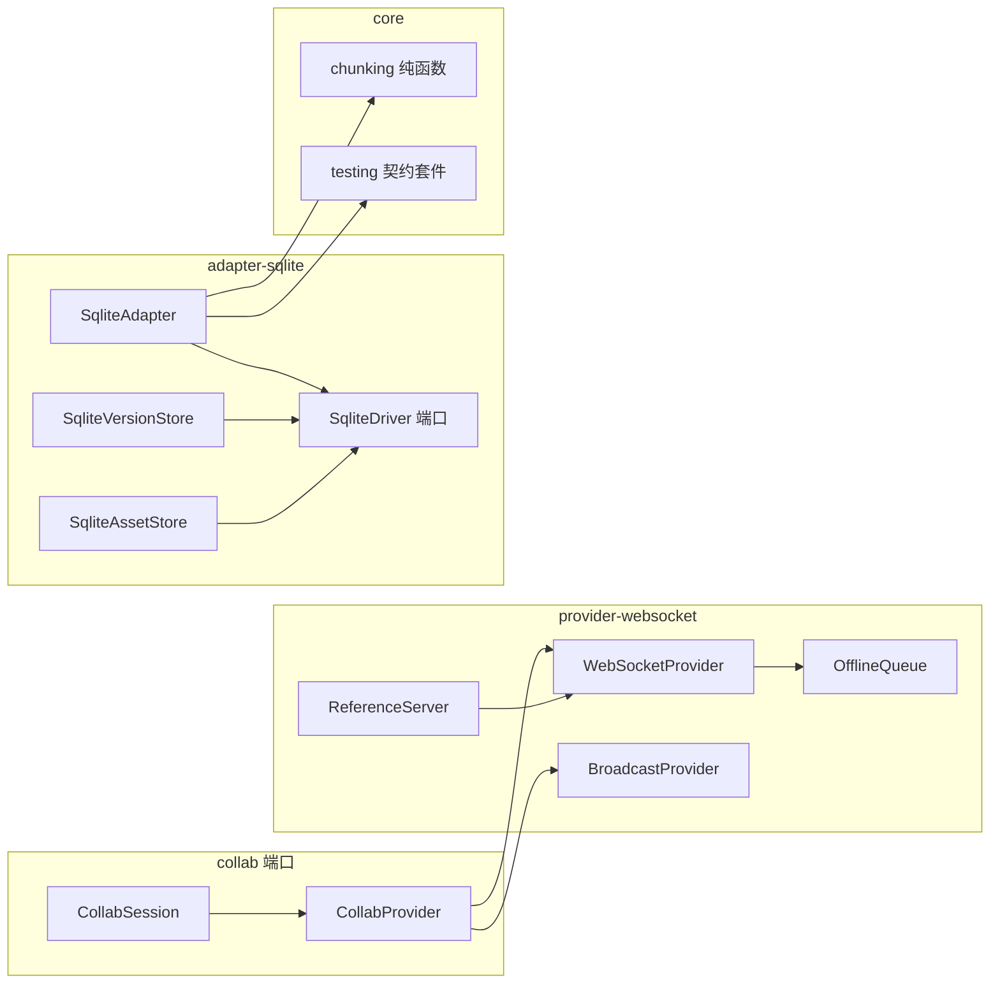

## 产品概述

收口 P2 剩余两项能力：为协同层补齐可用的网络传输（WebSocket 客户端与本地多标签同步，含可运行参考服务端），为 Electron / 本地优先宿主补齐 SQLite 存储（能力与 IndexedDB 持平）。两项均为基础设施包，不改动现有编辑器 / 阅读器交互。

## 核心功能

### 一、协同网络 Provider（G2）

- WebSocket 客户端 Provider：按 `CollabProvider` 契约实现连接、状态订阅、绑定与销毁；连接后完成「加入房间 → 拉取服务端全量状态 → 合并本地待发更新 → 持续双向增量同步」。
- 断线自动重连：指数退避 + 抖动，重连成功后重置退避；手动断开不自动重连。
- 离线编辑不丢：断线期间的本地更新合并为一条待发载荷，重连后一次发送；待发体积超限时改为发送本地全量状态，保证不丢改动、不产生重复块。
- 协议校验：版本不匹配或帧结构非法时给出结构化错误并断开，不静默吞帧。
- 本地多标签 Provider：同一浏览器同源多标签通过 BroadcastChannel 互相同步；迟到加入者主动索取并接收全量状态；不回放自身消息。
- 参考 Node 服务端：可按房间（书目 id）聚合与广播更新，新加入者先收全量状态；支持指定端口启动，供本地联调与测试使用。
- 状态可观测：连接状态在未连接 / 连接中 / 已连接之间可订阅，重连次数与最后错误可读。

### 二、SQLite 存储适配器（H2）

- 驱动由宿主注入：适配器包不安装、不打包任何 SQLite 引擎；宿主传入自己安装的驱动实例即可（Electron 主进程 / Node / 浏览器 WASM 均可）。
- 文档持久化：文档按「骨架 + 片」落盘，只重写引用变化的片；读取缺片时按记录损坏处理，不返回半截文档。
- 书架能力对齐 IndexedDB：摘要含作者、ISBN、标签、封面缩略图、字数、进度、最近阅读时间；支持检索 / 排序 / 分组与仅更新摘要（阅读进度）而不重写正文。
- 资产存储：图片 / 字体 / 音频等二进制以 BLOB 落库，写入返回含内容哈希的元信息，1 MB 资产往返字节一致。
- 历史版本：快照元信息与正文分列存储，支持列表、读取、删除与按「最多 N 份 / 按天」清理；清理只删过期项，非法策略拒绝执行。
- 结构自迁移：首次打开自动建表与索引，重复打开幂等；删除文档级联清理其分片，资产与历史版本不受文档清空影响。
- 事务与错误：单次保存、恢复、清理均在事务内完成，任一步失败整体回滚并保留原数据。

## 技术栈

- 语言 / 构建：TypeScript（ES2020、`strict`、`verbatimModuleSyntax`）+ pnpm workspace（`packages/*` 已通配）+ turbo + tsup。
- 测试：vitest（Node 环境）；G2 用 `ws` 作 devDependency 起真实服务端，H2 用 `sql.js`（WASM）作 devDependency 跑真实 SQL。
- 运行时依赖：`@bibliotype/provider-websocket` → `@bibliotype/collab` + `yjs` + `@bibliotype/core`；`@bibliotype/adapter-sqlite` → `@bibliotype/core`。**两个包均不新增 SQLite / WebSocket 运行时依赖**；`ws` 仅作为参考服务端的可选 peer（`peerDependenciesMeta.optional = true`）+ devDependency。
- 版本：两个新包 `0.1.0`，加入 `.changeset/config.json` 的 `fixed` 列车。

## 实现策略

### 1. G2：协议层与传输层分离，纯函数承担可测逻辑

- `protocol.ts`：文本帧（JSON + base64 载荷），客户端帧 `join` / `update` / `ping`，服务端帧 `joined` / `sync` / `update` / `pong` / `error`；`parseServerFrame` 做结构校验与版本判定，非法返回 `undefined` 或结构化错误码。
- `backoff.ts`：`nextReconnectDelay(attempt, { baseDelayMs, maxDelayMs, jitterRatio, random })` 纯函数，`random` 可注入，测试固定值。
- `offline-queue.ts`：用 `Y.mergeUpdates` 把待发更新合并为单条；记录合并后字节数，超过 `maxQueueBytes`（缺省 1 MiB）置 `needsFullSync` 并释放队列，重连后改发 `Y.encodeStateAsUpdate(ydoc)`。
- `websocket-provider.ts`：`socketFactory` 注入（浏览器原生 / `ws` / 假 socket），统一 `addEventListener` 与 `on` 两种事件风格、`MessageEvent` 与字符串 / Buffer 两种数据形态；状态机严格复用 `PROVIDER_STATUS`；远端更新以 provider 自身为 origin 应用，避免回播。
- `broadcast-provider.ts`：`channelFactory` 注入；`hello` 索取状态、`state` 定向回包、`update` 广播；按 `from` 过滤自身消息，迟到加入者能拿到已有文档。
- 参考服务端 `src/server/reference-server.ts`：`ws` + `yjs`，按 `docId` 分房间持有 `Y.Doc`，加入即回 `joined` + 全量 `sync`，更新应用后广播给同房间其他连接；导出 `startReferenceServer({ port = 0 })` 便于测试取随机端口，直接运行则打印监听地址。
- 明确不做：Awareness 远端光标（G3 暂缓）只保留协议扩展位；demo 不接协同（G1 增量绑定未落地，接入等于全量重载）。

### 2. H2：驱动端口 + SQL 方言适配器，核心逻辑与引擎解耦

- 驱动端口 `SqliteDriver` 只暴露 `exec / prepare / transaction / close`，语句层 `run / get / all` 全异步；同时提供 `createBetterSqliteDriver(database)`（变参 API）与 `createSqlJsDriver(database)`（`bind/step/getAsObject` API）两个鸭子类型包装器，均不 import 引擎包。
- 表结构（`PRAGMA user_version` 迁移，v1）：
- `documents(id PK, title, metadata JSON, summary JSON, skeleton JSON, chunk_ids JSON, updated_at)` + `updated_at` 索引；
- `chunks(doc_id, chunk_id, nodes JSON, PK(doc_id, chunk_id))`，外键 `ON DELETE CASCADE`；
- `assets(id PK, kind, media_type, name, byte_length, hash, data BLOB)`；
- `versions(doc_id, version, meta JSON, snapshot JSON, created_at, PK(doc_id, version))`；
- `settings(key PK, value)` 供样式 / 偏好等小载荷使用（宿主侧 KV）。
- 保存流程与 IndexedDB 完全同构：读旧摘要与内存分片记忆 → `buildChunkedSnapshot` → 计算 `carryOverSummaryFields` + 字数 → 单事务 upsert 文档、写变更片、删孤儿片。
- `list` 只读 `summary` 列；缺字段 / 旧记录结构走 `isDocumentSummary` + `buildDocumentSummary` 回退；`query` 复用 `queryDocumentSummaries`；`updateSummary` 用 `mergeDocumentSummary` 写回摘要列，返回最新摘要。
- `close()` 为无操作标记（驱动生命周期归宿主，避免共享驱动被关掉）；`clear()` 仅清文档与分片，保留资产与历史版本（与 IDB 版本仓独立同口径）。
- 资产：`toAssetRef` 统一 hash / kind 口径；BLOB 读出统一归一化为 `Uint8Array`（兼容 Buffer）。
- 版本仓：`SqliteVersionStore({ driver })` 复用同一驱动、独立表；`pruneVersions` 先 `selectExpiredSnapshots` 再按版本号批量删除。

### 3. 共享内核上移，避免第二套分片 / 契约逻辑

- `chunked-store.ts`（纯函数，只依赖 core 类型）上移到 `core/src/storage/chunking.ts` 并从 core 具名导出；`adapter-indexeddb` 的 `index.ts` 改为从 core 再导出，保持既有公开 API 不变；其测试迁移为 `core/src/__tests__/chunking.test.ts`。
- 公共契约测试套件上移到 `core/src/testing/storage-contract.ts`，以 `@bibliotype/core/testing` 子入口发布（ESM-only，`external: ['vitest']`，仅供测试）；`adapter-indexeddb` 与 `adapter-sqlite` 的测试统一从该子入口导入 `runStorageContractTests` / `sampleDocument`。
- `core` 的 tsup 改为多入口配置（主入口 esm+cjs，`testing` 入口仅 esm），`package.json` 增 `./testing` 导出；主入口不引入 vitest。

### 4. 测试口径

- G2：协议解析（合法 / 非法 / 版本不匹配）、退避序列（固定 random）、离线队列合并与溢出转全量、假 socket 下的握手与双向同步、重连后 10 次离线编辑一致且块数不翻倍、BroadcastChannel 双端互通与迟到加入、真实 `ws` 服务端 e2e（端口 0）。
- H2：`sql.js` 内存库 + `createSqlJsDriver`，复用公共契约套件（save/load/list/delete/clear/close + 可选端口探测）；另测分片增量（结构不变时片行数不变）、重启后读取、事务回滚、资产 1 MB 往返与 hash、摘要补丁、版本仓 CRUD / 保留策略 / 幂等。
- 全量门禁：`pnpm build`、`pnpm test`、`pnpm typecheck` 全绿（涉及 core 必须全量）。

### 5. 发布与文档

- `.changeset/config.json` 的 `fixed` 组追加两个新包；单一 changeset 覆盖两包（minor）与 core / adapter-indexeddb 的兼容性改动。
- `docs/09` 补 WebSocket / BroadcastChannel 用法、帧结构、重连与离线队列语义、参考服务端启动方式；`docs/10` 用真实章节替换「规划中的适配器」，写清驱动注入、表结构、可选端口、与 IDB 的差异（close / clear / 版本同库）；`docs/14` 增 SQLite 与重连两类 FAQ；两个新包 README + 台账收口。

## 关键结构

```ts
export type SqlValue = string | number | null | Uint8Array;

export interface SqliteStatement {
  run(params?: readonly SqlValue[] | Record<string, SqlValue>): Promise<{ changes: number }>;
  get(params?: readonly SqlValue[] | Record<string, SqlValue>): Promise<Record<string, unknown> | undefined>;
  all(params?: readonly SqlValue[] | Record<string, SqlValue>): Promise<Record<string, unknown>[]>;
}

export interface SqliteDriver {
  readonly name: string;
  exec(sql: string): Promise<void>;
  prepare(sql: string): SqliteStatement;
  transaction(run: (tx: SqliteDriver) => Promise<void>): Promise<void>;
  close(): Promise<void>;
}

export const COLLAB_PROTOCOL_VERSION = 1;

export type ServerFrame =
  | { t: 'joined'; protocol: number; clientId: string }
  | { t: 'sync'; update: string }
  | { t: 'update'; update: string }
  | { t: 'pong'; at: number }
  | { t: 'error'; code: 'PROTOCOL_MISMATCH' | 'BAD_FRAME'; message: string };
```

## 性能与可靠性

- SQLite 单次保存只写变更片并在一个事务内提交；`list` 不解析正文；资产 BLOB 直读直写；版本清理用单条 `DELETE ... WHERE version IN (...)`。
- 外键级联 + `PRAGMA foreign_keys = ON`；任何写失败 `ROLLBACK`，原数据保持可读。
- 离线队列合并为单条载荷，重连只发一次；超限转全量，靠 Yjs 幂等合并保证不重复。
- 退避有上限与抖动，避免雪崩；手动断开不重连；`destroy` 后操作抛错，防止悬挂定时器。
- 协议帧大小设上限（缺省 8 MiB）并在解析前检查，防止异常载荷拖垮主线程。

## 架构



## 目录结构

```text
packages/provider-websocket/
├── package.json                    # [NEW] name/version 0.1.0；deps: collab+yjs+core；devDeps: ws、@types/ws、tsup、ts、vitest；exports 含 ./server；ws 为可选 peer
├── tsconfig.json                   # [NEW] 继承 tsconfig.base，rootDir src
├── tsup.config.ts                  # [NEW] 入口 index 与 server/reference-server；esm+cjs+dts；external collab/yjs/core/ws
├── README.md                       # [NEW] 快速上手、协议、重连与离线队列、参考服务端 CLI
├── src/index.ts                    # [NEW] 具名导出 Provider、协议常量、退避与队列工具
├── src/protocol.ts                 # [NEW] 帧类型、编解码、结构校验、版本判定、帧大小上限
├── src/backoff.ts                  # [NEW] nextReconnectDelay 纯函数（random 可注入）
├── src/offline-queue.ts            # [NEW] 合并待发更新、字节上限、溢出转全量标志
├── src/socket.ts                   # [NEW] WebSocketLike 鸭子类型、事件绑定与消息归一化、默认工厂
├── src/websocket-provider.ts       # [NEW] 连接状态机、握手、重连调度、离线队列对接
├── src/broadcast-provider.ts       # [NEW] BroadcastChannel 多标签同步、迟到加入、自消息过滤
├── src/server/reference-server.ts  # [NEW] ws + yjs 参考服务端（按 docId 分房间、随机端口、CLI）
└── src/__tests__/
    ├── protocol.test.ts            # [NEW] 合法/非法帧、版本不匹配、超限
    ├── backoff.test.ts             # [NEW] 退避序列、上限、抖动边界
    ├── offline-queue.test.ts       # [NEW] 合并、溢出转全量、清空
    ├── websocket-provider.test.ts  # [NEW] 假 socket 握手、双向同步、重连 10 次编辑一致
    ├── broadcast-provider.test.ts  # [NEW] 双端互通、迟到加入、断开停止
    └── e2e-server.test.ts          # [NEW] 真实 ws 服务端 + 两个客户端同步与重连

packages/adapter-sqlite/
├── package.json                    # [NEW] deps: core；devDeps: sql.js、tsup、ts、vitest
├── tsconfig.json                   # [NEW] 继承基础配置
├── tsup.config.ts                  # [NEW] 单入口、esm+cjs+dts、external core
├── README.md                       # [NEW] 驱动注入示例（better-sqlite3 / sql.js）、表结构、与 IDB 差异
├── src/index.ts                    # [NEW] 导出适配器、驱动工厂、版本仓、KV 存储与类型
├── src/driver.ts                   # [NEW] SqliteDriver 端口、better-sqlite3 / sql.js 包装、事务辅助
├── src/schema.ts                   # [NEW] DDL、索引、user_version 迁移（幂等）
├── src/sqlite-adapter.ts           # [NEW] StorageAdapter + BookLibraryStore + BookSummaryStore（分片、摘要、查询）
├── src/asset-store.ts              # [NEW] AssetStore：BLOB 读写、元信息、hash、去重口径
├── src/version-store.ts            # [NEW] DocumentVersionStore：upsert、列表、删除、保留策略
├── src/key-value.ts                # [NEW] settings 表上的 get/set/remove（样式与偏好小载荷）
└── src/__tests__/
    ├── helpers/sqljs.ts            # [NEW] 加载 sql.js WASM、建内存库、构造驱动
    ├── sqlite-driver.test.ts       # [NEW] 迁移幂等、事务回滚、BLOB 归一化
    ├── sqlite-adapter.test.ts      # [NEW] 公共契约套件 + 分片增量 + 重启读取 + 查询/摘要补丁
    ├── sqlite-asset.test.ts        # [NEW] 1MB 往返字节一致、hash、列表与删除
    └── sqlite-version-store.test.ts# [NEW] CRUD、保留策略、幂等、非法策略拒绝

packages/core/
├── src/storage/chunking.ts         # [NEW] 由 adapter-indexeddb/chunked-store.ts 迁入（纯函数，原样保留签名）
├── src/testing/storage-contract.ts # [NEW] 由 adapter-indexeddb 测试迁入，改为从 core 主入口取类型
├── src/testing/index.ts            # [NEW] 测试子入口聚合导出
├── src/index.ts                    # [MODIFY] 增 chunking 具名导出
├── src/__tests__/chunking.test.ts  # [NEW] 由 adapter-indexeddb 的分片测试迁入
├── package.json                    # [MODIFY] exports 增 "./testing"；files 仍只发 dist
└── tsup.config.ts                  # [MODIFY] 多入口：index（esm+cjs）与 testing（仅 esm，external vitest）

packages/adapter-indexeddb/
├── src/indexeddb-adapter.ts        # [MODIFY] 分片函数改从 core 导入，删除对本地 chunked-store 的依赖
├── src/index.ts                    # [MODIFY] 分片符号改为从 core 再导出（公开 API 不变）
├── src/chunked-store.ts            # [DELETE] 已上移 core
└── src/__tests__/
    ├── storage-contract.ts         # [DELETE] 已上移 core/testing
    ├── chunked-store.test.ts       # [DELETE] 已上移 core
    ├── memory-adapter.test.ts      # [MODIFY] 改从 @bibliotype/core/testing 导入契约套件
    ├── indexeddb-adapter.test.ts   # [MODIFY] 同上
    └── version-store.test.ts       # [MODIFY] sampleDocument 改从 core/testing 导入

docs/09-collab.md                   # [MODIFY] WebSocket / BroadcastChannel 用法、帧结构、重连与离线队列、参考服务端
docs/10-storage-adapters.md         # [MODIFY] SQLite 适配器真实章节：驱动注入、表结构、可选端口、与 IDB 差异
docs/14-faq.md                      # [MODIFY] 新增 SQLite 驱动注入 / 协议重连两类 FAQ
能力扩展实施计划清单.md              # [MODIFY] P2-2 / P2-8 勾选与交付记录、总览与门禁收口
.changeset/config.json              # [MODIFY] fixed 组追加两个新包
.changeset/p2-provider-sqlite.md    # [NEW] 两包 minor + core / adapter-indexeddb 兼容性说明
pnpm-lock.yaml                      # [MODIFY] 新增 sql.js / ws / @types/ws 的 devDependency 解析
```

## 执行注意

1. `chunking` 上移必须保持函数签名与导出名完全一致，`adapter-indexeddb` 只做再导出；迁移后先跑该包测试与 core 全量测试，确认没有行为漂移。
2. `@bibliotype/core/testing` 仅 ESM，`tsup` 的第二入口必须 `external: ['vitest']` 并单独产出 `.d.ts`；主入口严禁引入 vitest，否则会污染生产产物。
3. SQLite 驱动包装只做「同步引擎 → 异步端口」的薄适配，不实现 SQL 解析；`transaction` 用 `BEGIN IMMEDIATE / COMMIT / ROLLBACK`，嵌套事务直接抛错。
4. BLOB 读出后统一转 `Uint8Array`（`Buffer` 是子类但结构化克隆 / 序列化行为不同，不能直接透传）。
5. `clear()` 不清资产与历史版本，`close()` 不关闭宿主驱动，两处差异必须在 README 与 docs/10 明写，避免宿主误判。
6. G2 重连测试用 `vi.useFakeTimers()` + 注入固定 `random`，断言退避序列；e2e 用端口 0，测试结束必须关闭服务端与所有连接，防止句柄泄漏。
7. 协议帧与离线队列都设上限；超限只走「全量同步」兜底，不允许静默丢弃更新。
8. demo 不接线协同与 SQLite（G1 增量绑定未落地、SQLite 需宿主驱动）；文档给出宿主示例即可。提交文本仍合并为一条中文 Conventional Commits。

## Agent Extensions

### SubAgent

- **code-explorer**
- Purpose: 在把分片器与公共契约套件上移到 `core` 之前，做一次定向影响核查：确认所有引用点（`adapter-indexeddb` 的 src 与 tests、core 的导出与 tsup 入口、turbo 的 `test dependsOn ^build`），以及 new package 的 `exports` 是否会破坏既有消费方。
- Expected outcome: 输出「受影响文件 + 符号 + 行号」清单，作为迁移与兼容再导出的改动边界，避免漏改导致全量测试或发布产物失败。